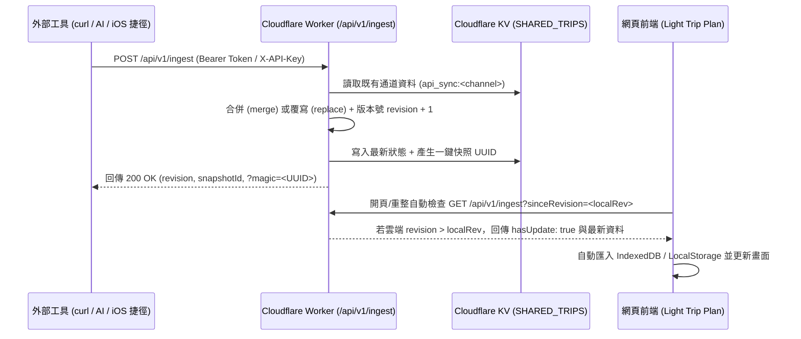

# 🔌 外部寫入與雲端自動同步 API 使用指南 (`API_GUIDE.md`)

本系統透過 **Cloudflare Worker + KV** 提供具備認證機制的 RESTful 寫入與同步接口（`/api/v1/ingest` 與別名 `/api/v1/sync`）。
您可透過 `curl`、Python / Node.js 腳本、iOS 捷徑（Shortcuts）、n8n / Make 自動化流程或 AI Agent 直接寫入**單筆機票、飯店、活動、景點、記帳**或**整包行程 JSON**；當您開啟或重新整理網頁時，前端將自動比對版本號（`revision`）並拉取最新資料匯入本地資料庫。

---

## 1. 運作流程架構



---

## 2. 前置設定

### 步驟一：於 Cloudflare Worker 設定 `API_SECRET_TOKEN`
1. 登入 [Cloudflare Dashboard](https://dash.cloudflare.com) ➔ **Workers & Pages** ➔ 選擇您的 Worker（如 `flight-api-proxy`）。
2. 進入 **Settings** ➔ **Variables and Secrets**。
3. 新增一組 Secret（建議使用高強度隨機字串）：
   - **Variable name**: `API_SECRET_TOKEN`
   - **Value**: 例如 `ltp_secret_9f8a7b6c5d4e3f2a1b`
4. 確認 **KV Namespace Bindings** 已綁定變數名稱 `SHARED_TRIPS`。

> 💡 若您使用 `wrangler` CLI，也可直接於 `cloudflare-worker/` 目錄執行：
> ```bash
> npx wrangler secret put API_SECRET_TOKEN
> ```

### 步驟二：於網頁端啟用自動拉取
1. 開啟網頁右上角 **「📤 匯入匯出 & 手冊」** ➔ 切換至 **「🔌 API 寫入接口」** 分頁。
2. 填入：
   - **Worker API 端點網址**：例如 `https://flight-api-proxy.your-account.workers.dev`
   - **API Secret Token**：填入步驟一設定的 `API_SECRET_TOKEN`
   - **雲端通道名稱 (Channel)**：預設為 `default`（亦可自訂如 `tokyo2026` 以區分不同行程通道）
   - **拉取後本地寫入策略**：選擇「覆寫同步 (`replace`)」或「合併同步 (`merge`)」
   - 勾選 **「每次開頁／重新整理自動拉取最新寫入」**
3. 點擊 **「💾 儲存設定」**。

---

## 3. 認證機制與多組子金鑰管理 (Authentication & Sub-Keys)

所有對 `/api/v1/ingest`（或 `/api/v1/sync`）的請求皆**強制要求認證**，支援以下任一 HTTP Header：

| Header 名稱 | 格式範例 | 說明 |
| :--- | :--- | :--- |
| **`Authorization`** | `Authorization: Bearer <TOKEN>` | 標準 Bearer Token 認證（推薦） |
| **`X-API-Key`** | `X-API-Key: <TOKEN>` | 適合 API Gateway、iOS 捷徑或 Webhook 工具 |

### 3.1 兩種金鑰層級
1. **Master Admin Token（主管理金鑰，`API_SECRET_TOKEN`）**
   - 設定於 Cloudflare Worker Secrets 中。
   - **支援逗號分隔多組靜態主金鑰**：例如 `API_SECRET_TOKEN = "ltp_master_1,ltp_master_2"`。
   - 擁有全通道讀寫刪權限，且**唯一有權呼叫 `/api/v1/keys` 簽發、查詢與撤銷子金鑰**。
2. **動態子金鑰（Sub-Keys，`ltp_sk_...`）**
   - 可直接在網頁端 **「📤 匯入匯出 & 手冊 ➔ 🔌 API 寫入接口 ➔ 🔑 多組子金鑰管理介面」** 簽發與撤銷。
   - **雲端零明文儲存**：Cloudflare KV (`api_keys:registry`) 僅儲存子金鑰的 **SHA-256 雜湊值 (`tokenHash`)** 與遮罩 (`ltp_sk_xxxx...xxxx`)，明文僅在簽發當下顯示一次。
   - **細粒度權限與通道隔離**：
     - **授權權限 (`permissions`)**：可設為「讀寫 (`read + write`)」、「僅寫入 (`write-only`)」或「唯讀 (`read-only`)」。
     - **允許通道 (`allowedChannels`)**：可設為 `*`（全部通道）或限定特定通道（如 `tokyo2026`），跨通道存取將回傳 `403 Forbidden`。
     - **有效期限 (`expiresInDays`)**：支援永久有效或指定天數（如 7 / 30 / 90 天）自動到期。
     - **一鍵立即撤銷**：撤銷後該子金鑰全球立即失效，不影響主金鑰與其他子金鑰。

### 3.2 子金鑰管理 API (`/api/v1/keys`，僅限 Master Token 呼叫)
```bash
# 1. 簽發新子金鑰 (POST /api/v1/keys)
curl -X POST "https://<YOUR_WORKER_URL>/api/v1/keys" \
  -H "Authorization: Bearer <YOUR_MASTER_API_SECRET_TOKEN>" \
  -H "Content-Type: application/json" \
  -d '{
    "label": "旅伴小明",
    "permissions": ["read", "write"],
    "allowedChannels": ["tokyo2026"],
    "expiresInDays": 30
  }'

# 2. 查詢已簽發子金鑰清單 (GET /api/v1/keys)
curl -X GET "https://<YOUR_WORKER_URL>/api/v1/keys" \
  -H "Authorization: Bearer <YOUR_MASTER_API_SECRET_TOKEN>"

# 3. 立即撤銷指定子金鑰 (DELETE /api/v1/keys?id=key_xxxx)
curl -X DELETE "https://<YOUR_WORKER_URL>/api/v1/keys?id=key_xxxx" \
  -H "Authorization: Bearer <YOUR_MASTER_API_SECRET_TOKEN>"
```

---

## 4. API 端點規格

### 4.1 寫入資料：`POST /api/v1/ingest`（或 `PUT /api/v1/ingest`）

將單筆項目或整包行程寫入指定雲端通道。

- **Query Parameters**：
  - `channel`（選填，預設 `default`）：通道名稱，僅允許英數字、底線與連字號（`^[a-zA-Z0-9_-]{1,64}$`）。
  - `mode`（選填，預設 `merge`）：
    - `merge`：將傳入的單筆或陣列資料依 `id` 合併至雲端既有狀態（同 `id` 更新、新 `id` 追加；若未傳 `id` 會自動配發 UUID）。
    - `replace`：以本次傳入的 JSON 完全取代該通道的雲端狀態（使用 `PUT` 方法時預設為 `replace`）。
- **Payload 大小上限**：`512 KB`。

#### 支援的 Request Body 欄位（可混搭傳入）

| 單筆簡寫欄位 (Object) | 批量陣列欄位 (Array) | 說明 |
| :--- | :--- | :--- |
| `"ticket": { ... }` | `"tickets": [ ... ]` | 機票訂單（含去回程日期、航班號、機場、票價 `price` / `priceTWD`） |
| `"hotel": { ... }` | `"hotels": [ ... ]` | 飯店住宿（含 `name`, `checkIn`, `checkOut`, `currency`, `priceTotal`, `priceTWD`, `lat`, `lng`） |
| `"activity": { ... }` | `"activities": [ ... ]` | 活動／交通／景點（含 `title`, `category`, `startDate`, `time`, `location`, `lat`, `lng`, `notes`） |
| `"place": { ... }` | `"places": [ ... ]` | 每日排程景點（含 `name`, `date` 或 `dayIndex`, `time`, `lat`, `lng`, `address`, `notes`） |
| `"day": { ... }` | `"days": [ ... ]` | 每日主題與景點清單（含 `day`, `date`, `theme`, `notes`, `places`） |
| `"expense": { ... }` | `"expenses": [ ... ]` | 多幣別記帳支出（含 `title`, `category`, `amount`, `currency`, `paidBy`） |
| `"packingItem": { ... }` | `"packingItems": [ ... ]` | 行李清單項目（含 `itemName`, `category`, `weightGrams`, `isPacked`） |
| `"todo": { ... }` | `"todos": [ ... ]` | 行前待辦事項（含 `title`, `priority`, `dueDate`, `completed`） |
| `"reservation": { ... }` | `"reservations": [ ... ]` | 16 種通用預訂項目 |

此外亦可傳入頂層物件：
- `"trip"`: `{ "title": "...", "startDate": "YYYY-MM-DD", "endDate": "YYYY-MM-DD", "budget": 62000, "baseCurrency": "TWD" }`
- `"tripLabels"`: `{ "<ticketId>-1": "自訂行程名稱" }`
- `"tripBudgets"`: `{ "<ticketId>-1": 62000 }`

#### 成功回應範例 (`200 OK`)
```json
{
  "success": true,
  "channel": "default",
  "mode": "merge",
  "revision": 3,
  "updatedAt": "2026-11-20T12:33:14.697Z",
  "snapshotId": "d543fc40-68d8-48bf-a4bf-09edb55ccf18",
  "magicImportQuery": "?magic=d543fc40-68d8-48bf-a4bf-09edb55ccf18",
  "shareViewQuery": "?view=d543fc40-68d8-48bf-a4bf-09edb55ccf18",
  "summary": {
    "tickets": 2,
    "hotels": 10,
    "activities": 25,
    "places": 0,
    "days": 12,
    "reservations": 0,
    "expenses": 0,
    "packingItems": 0,
    "todos": 0
  }
}
```

---

### 4.2 讀取／增量拉取：`GET /api/v1/ingest`

供網頁前端開頁自動拉取或外部程式查詢雲端通道最新狀態。

- **Query Parameters**：
  - `channel`（選填，預設 `default`）
  - `sinceRevision`（選填）：傳入本地目前已同步的版本號（如 `sinceRevision=3`）。
    - 若雲端 `revision <= sinceRevision`，回傳 `{ "success": true, "revision": 3, "hasUpdate": false }`（不回傳 `data`，節省流量）。
    - 若雲端 `revision > sinceRevision` 或未傳 `sinceRevision`，回傳 `{ "success": true, "revision": 4, "hasUpdate": true, "data": { ... } }`。

---

### 4.3 清空雲端通道：`DELETE /api/v1/ingest`

清除指定 `channel` 在 Cloudflare KV 中的同步資料。

- **Query Parameters**：`?channel=default`
- **回應 (`200 OK`)**：`{ "success": true, "channel": "default", "cleared": true }`

---

## 5. 實戰呼叫範例

### 範例一：單筆追加一項新活動／景點 (`curl`)
> 💡 當雲端資料未顯式鎖定 `places` 時，寫入帶有 `startDate`、`time`、`lat`、`lng` 的 `activity` 在前端拉取後會**同時出現在「票券與活動」、「預訂總覽」、「每日排程時間表」與「右側互動地圖」**！

```bash
curl -X POST "https://<YOUR_WORKER_URL>/api/v1/ingest?channel=default&mode=merge" \
  -H "Authorization: Bearer <YOUR_API_SECRET_TOKEN>" \
  -H "Content-Type: application/json" \
  -d '{
    "activity": {
      "id": "act-2026-1225-dinner",
      "title": "六本木燒肉晚餐",
      "category": "dining",
      "startDate": "2026-12-25",
      "time": "19:30",
      "location": "六本木之丘",
      "currency": "JPY",
      "exchangeRate": 0.22,
      "price": 8000,
      "priceTWD": 1760,
      "lat": 35.6604,
      "lng": 139.7292,
      "notes": "已預約 19:30 雙人位"
    }
  }'
```

### 範例二：單筆追加一間飯店住宿 (`curl`)
```bash
curl -X POST "https://<YOUR_WORKER_URL>/api/v1/ingest?channel=default&mode=merge" \
  -H "X-API-Key: <YOUR_API_SECRET_TOKEN>" \
  -H "Content-Type: application/json" \
  -d '{
    "hotel": {
      "id": "hotel-toyoko-bakurocho-1223",
      "name": "東橫INN 東京日本橋馬喰町",
      "address": "14-16 Odenma-cho, Nihombashi, Chuo-ku, Tokyo",
      "checkIn": "2026-12-23",
      "checkOut": "2026-12-24",
      "currency": "JPY",
      "priceTotal": 8835,
      "priceTWD": 1781,
      "confirmationNo": "6461161",
      "notes": "吸煙單人房",
      "isPaid": true,
      "lat": 35.6811836,
      "lng": 139.7741538
    }
  }'
```

### 範例三：整包行程 JSON 覆寫上傳 (`curl`)
```bash
curl -X POST "https://<YOUR_WORKER_URL>/api/v1/ingest?channel=default&mode=replace" \
  -H "Authorization: Bearer <YOUR_API_SECRET_TOKEN>" \
  -H "Content-Type: application/json" \
  -d @trip-backup.json
```

### 範例四：使用 Python 腳本自動寫入行程
```python
import requests

WORKER_URL = "https://<YOUR_WORKER_URL>/api/v1/ingest"
API_TOKEN = "<YOUR_API_SECRET_TOKEN>"

resp = requests.post(
    WORKER_URL,
    params={"channel": "default", "mode": "merge"},
    headers={"Authorization": f"Bearer {API_TOKEN}"},
    json={
        "activity": {
            "id": "act-2026-1226-nikko",
            "title": "日光東照宮參拜",
            "category": "attraction",
            "startDate": "2026-12-26",
            "time": "11:45",
            "location": "日光東照宮",
            "currency": "JPY",
            "exchangeRate": 0.22,
            "price": 2200,
            "priceTWD": 484,
            "lat": 36.7581,
            "lng": 139.5988,
            "notes": "世界遺產巡遊巴士一日券 ¥600 + 門票 ¥1,600"
        }
    },
    timeout=10,
)
print(resp.status_code, resp.json())
```

---

## 6. HTTP 狀態碼與錯誤排解

| 狀態碼 | 原因 | 解決方式 |
| :--- | :--- | :--- |
| **`200 OK`** | 寫入或讀取成功 | 回傳 JSON 內含 `revision` 與 `summary` |
| **`400 Bad Request`** | JSON 語法錯誤或根節點非物件／陣列 | 檢查 JSON 格式是否合法（有無多餘逗號或未閉合引號） |
| **`401 Unauthorized`** | 缺少認證標頭或 Token 不符 | 確認 Header 是否帶有正確的 `Authorization: Bearer <TOKEN>` 或 `X-API-Key` |
| **`413 Payload Too Large`** | 單次請求超過 `512 KB` | 請移除非必要的大型 Base64 字串，大檔請改用「整備中心 ➔ 雲端大檔」直傳 Google Drive |
| **`500 Internal Server Error`** | `SHARED_TRIPS` KV 未綁定 | 於 Cloudflare Worker Settings ➔ Bindings 綁定 `SHARED_TRIPS` KV Namespace |
| **`503 Service Unavailable`** | Worker 尚未設定 `API_SECRET_TOKEN` | 於 Cloudflare Worker Settings ➔ Variables and Secrets 新增 `API_SECRET_TOKEN` |
