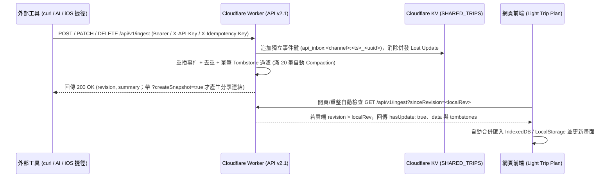

# 🔌 外部寫入與雲端自動同步 API 使用指南 (`API_GUIDE.md` · v2.1)

本系統透過 **Cloudflare Worker + KV** 提供具備認證機制的 RESTful 寫入、局部更新、單筆刪除、篩選查詢與標準格式匯出接口。
您可透過 `curl`、Python / Node.js 腳本、iOS 捷徑（Shortcuts）、n8n / Make 自動化流程或 AI Agent（支援 OpenAPI 3.1）直接操作**機票、飯店、活動、景點、預訂、記帳、待辦與旅伴共筆**；當開啟或重新整理網頁時，前端會自動比對版本號（`revision`）並拉取最新資料同步至本地資料庫。

---

## 1. 運作流程架構（Append-Only Inbox + 自動壓縮）



---

## 2. 前置設定

### 步驟一：於 Cloudflare Worker 設定環境變數與 Secrets
1. 登入 [Cloudflare Dashboard](https://dash.cloudflare.com) ➔ **Workers & Pages** ➔ 選擇您的 Worker（如 `flight-api-proxy`）。
2. 進入 **Settings** ➔ **Variables and Secrets**：
   - **`API_SECRET_TOKEN`**（必填，Secret）：高強度隨機字串，支援逗號分隔多組主管理金鑰（例如 `ltp_master_1,ltp_master_2`）。
   - **`ALLOWED_ORIGINS`**（選填）：逗號分隔 CORS 白名單（預設已放行 `https://imhahac.github.io` 與 `http://localhost:5173`）。
   - **`REQUIRE_PROXY_AUTH`**（選填）：設為 `"true"` 可強制 `?api=aviationstack|airlabs` 代理端點必須攜帶有效 Token。
3. 確認 **KV Namespace Bindings** 已綁定變數名稱 `SHARED_TRIPS`。

```bash
# 使用 wrangler CLI 設定主管理金鑰
npx wrangler secret put API_SECRET_TOKEN
```

### 步驟二：於網頁端啟用自動拉取與互動測試
1. 開啟網頁右上角 **「📤 匯入匯出 & 手冊」** ➔ 切換至 **「🔌 API 寫入接口」** 分頁。
2. 填入 **Worker API 端點網址**、**同步 Token（推薦使用限權子金鑰 `ltp_sk_...`）** 與 **雲端通道名稱 (`channel`)**。
3. 點擊 **「測試連線 & 檢查金鑰 (whoami)」** 確認連線與權限，預設拉取策略為安全的「合併同步 (`merge`)」。

---

## 3. 認證機制、子金鑰與安全防護

所有受保護的 `/api/v1/*` 端點皆強制要求認證，支援以下 HTTP Headers：

| Header 名稱 | 格式範例 | 說明 |
| :--- | :--- | :--- |
| **`Authorization`** | `Authorization: Bearer <TOKEN>` | 標準 Bearer Token 認證（推薦） |
| **`X-API-Key`** | `X-API-Key: <TOKEN>` | 適合 API Gateway、iOS 捷徑或 Webhook 工具 |
| **`X-Idempotency-Key`** | `X-Idempotency-Key: act-20261225-01` | 選填（最長 64 字元）；重試相同 Key 時自動去重，避免重複寫入 |

### 3.1 權限層級與安全防護
- **Master Admin Token (`API_SECRET_TOKEN`)**：全通道 `read / write / delete / admin` 權限，且唯一有權呼叫 `/api/v1/keys` 與 `/api/v1/channels`。
- **動態子金鑰 (`ltp_sk_...`)**：於 KV 僅存 **SHA-256 雜湊值**，可細粒度限定 `permissions`（`read` / `write` / `delete`）、`allowedChannels` 與 `expiresInDays`；支援一鍵即時撤銷。
- **防暴力破解速率限制 (Rate Limit)**：對同一真實來源 IP (`CF-Connecting-IP`) 在 60 秒內累積 20 次 `401` 認證失敗，自動回傳 **`429 Too Many Requests`**（附 `Retry-After: 60`）。
- **CORS 嚴格白名單**：僅放行白名單來源並允許 `GET, POST, PUT, PATCH, DELETE, OPTIONS`。

### 3.2 子金鑰管理 API (`/api/v1/keys`，僅限 Master Token)
```bash
# 1. 簽發新子金鑰 (POST /api/v1/keys)
curl -X POST "https://<YOUR_WORKER_URL>/api/v1/keys" \
  -H "Authorization: Bearer <YOUR_MASTER_TOKEN>" \
  -H "Content-Type: application/json" \
  -d '{
    "label": "旅伴小明",
    "permissions": ["read", "write"],
    "allowedChannels": ["tokyo2026"],
    "expiresInDays": 30
  }'

# 2. 查詢已簽發子金鑰清單 (GET /api/v1/keys)
curl -X GET "https://<YOUR_WORKER_URL>/api/v1/keys" \
  -H "Authorization: Bearer <YOUR_MASTER_TOKEN>"

# 3. 立即撤銷指定子金鑰 (DELETE /api/v1/keys?id=key_xxxx)
curl -X DELETE "https://<YOUR_WORKER_URL>/api/v1/keys?id=key_xxxx" \
  -H "Authorization: Bearer <YOUR_MASTER_TOKEN>"
```

---

## 4. 完整 API 端點總覽 (v2.1)

| 方法 | 路徑 | 權限要求 | 用途說明 |
| :--- | :--- | :---: | :--- |
| `GET` | `/api/v1/health` | 公開 | 健康檢查（版本、KV 綁定狀態、時間戳，零 KV 讀取） |
| `GET` | `/api/v1/openapi.json` | 公開 | OpenAPI 3.1 規格書（可一鍵匯入 Postman / n8n / AI Agent） |
| `GET` | `/api/v1/whoami` | 任一有效 Token | 查詢目前 Token / 子金鑰之角色、權限、允許通道與到期日 |
| `GET` | `/api/v1/channels` | Master Admin | 列出所有活躍同步通道（嚴格排除系統內部鍵） |
| `GET` | `/api/v1/ingest` | `read` | 讀取通道資料（支援 `sinceRevision`、`summaryOnly`、`type`、`date`） |
| `POST` / `PUT` | `/api/v1/ingest` | `write` | 寫入／合併／覆寫資料（支援 `X-Idempotency-Key`、`dryRun=true`、`createSnapshot=true`） |
| `PATCH` | `/api/v1/ingest` | `write` | 依 `id` 局部更新既有項目欄位（不覆蓋其他欄位） |
| `DELETE` | `/api/v1/ingest` | `delete` | 帶 `?type=&id=` 為**單筆 Tombstone 刪除**；未帶則清空整個通道 |
| `POST` | `/api/v1/ingest/compact` | `write` | 手動觸發指定通道 Inbox 壓縮合併回單一快照鍵 |
| `GET` | `/api/v1/export` | `read` | 直接匯出標準檔案（`format=ics \| gpx \| csv \| json`） |
| `GET / POST / DELETE` | `/api/v1/keys` | Master Admin | 子金鑰清單、簽發與撤銷 |

> 💡 `/api/v1/sync` 為 `/api/v1/ingest` 的完全等效別名。

---

## 5. 核心端點詳細規格

### 5.1 寫入與局部更新：`POST` / `PUT` / `PATCH /api/v1/ingest`

- **Query Parameters**：
  - `channel`（選填，預設 `default`）：`^[a-zA-Z0-9_-]{1,64}$`
  - `mode`（選填，預設 `merge`；`PUT` 預設 `replace`；`PATCH` 強制 `merge`）
  - `dryRun=true`（選填）：僅驗證格式並回傳預期 `projectedSummary`，**不寫入 KV**（零額度消耗）
  - `createSnapshot=true`（選填，預設 `false`）：顯式要求時才建立 30 天免認證 `?magic=` / `?view=` 公開快照，避免機敏資料隱性暴露
- **Payload 大小上限**：`512 KB`。

#### 支援的 Request Body 欄位（可混搭傳入）

| 單筆簡寫欄位 (Object) | 批量陣列欄位 (Array) | 說明 |
| :--- | :--- | :--- |
| `"ticket": { ... }` | `"tickets": [ ... ]` | 機票訂單（去回程日期、航班號、機場、票價） |
| `"hotel": { ... }` | `"hotels": [ ... ]` | 飯店住宿（`name`, `checkIn`, `checkOut`, `priceTotal`, `lat`, `lng`） |
| `"activity": { ... }` | `"activities": [ ... ]` | 活動／交通／景點（`title`, `startDate`, `time`, `lat`, `lng`, `notes`） |
| `"place": { ... }` | `"places": [ ... ]` | 每日排程景點（`name`, `dayIndex`, `lat`, `lng`, `rating`, `travelModeToNext`） |
| `"day": { ... }` | `"days": [ ... ]` | 每日主題與景點清單 |
| `"reservation": { ... }` | `"reservations": [ ... ]` | 18 種通用預訂憑證 |
| `"expense": { ... }` | `"expenses": [ ... ]` | 多幣別記帳支出（支援 `paidBy` 或多人 `payers`） |
| `"packingItem": { ... }` | `"packingItems": [ ... ]` | 行李清單項目（含 `bagName`, `weightGrams`, `isPacked`） |
| `"todo": { ... }` | `"todos": [ ... ]` | 行前待辦事項（含 `priority`, `dueDate`, `isDone`） |
| `"collabItem": { ... }` | `"collabItems": [ ... ]` | 旅伴共筆項目（`kind: note \| link \| poll \| next`） |

---

### 5.2 讀取與篩選查詢：`GET /api/v1/ingest`

- **Query Parameters**：
  - `channel`（選填，預設 `default`）
  - `sinceRevision`（選填）：若雲端 `revision <= sinceRevision`，回傳 `hasUpdate: false`（不傳 `data`）。
  - `summaryOnly=true`（選填）：僅回傳 `revision`、`updatedAt`、`summary` 與 `tombstoneCount`（省流量與 AI Token）。
  - `type`（選填，逗號分隔）：例如 `type=activities,expenses`，僅回傳指定陣列。
  - `date`（選填，`YYYY-MM-DD`）：僅回傳符合該日期的項目。
- 帶入 `type` 或 `date` 時，回應將明確標記 **`"filtered": true`**，並於一般讀取回應附帶 **`"tombstones": [...]`** 供同步端識別已刪除項目。

---

### 5.3 單筆刪除與清空：`DELETE /api/v1/ingest`（需 `delete` 權限）

- **單筆 Tombstone 刪除（推薦）**：
  - `?channel=<ch>&type=<field>&id=<itemId>`
  - 不會清空整個通道；於 Inbox 記錄 Tombstone 並於讀取時濾除該筆項目。
- **清空整個通道**：
  - `?channel=<ch>`（不帶 `type` 與 `id`），將刪除該通道所有 `api_sync:` 與 `api_inbox:` 鍵。

---

### 5.4 標準格式直接匯出：`GET /api/v1/export`（需 `read` 權限）

- **Query Parameters**：
  - `channel`（選填，預設 `default`）
  - `format`：`ics`（RFC 5545 行事曆）、`gpx`（GPX 1.1 航點）、`csv`（費用報表 UTF-8 BOM，自動防 Excel 公式注入）、`json`（預設）。

---

## 6. 實戰呼叫範例

### 範例一：單筆追加活動（含 `X-Idempotency-Key` 冪等保護）
```bash
curl -X POST "https://<YOUR_WORKER_URL>/api/v1/ingest?channel=tokyo2026&mode=merge" \
  -H "Authorization: Bearer <YOUR_TOKEN>" \
  -H "X-Idempotency-Key: act-20261225-dinner-01" \
  -H "Content-Type: application/json" \
  -d '{
    "activity": {
      "id": "act-2026-1225-dinner",
      "title": "六本木燒肉晚餐",
      "category": "dining",
      "startDate": "2026-12-25",
      "time": "19:30",
      "location": "六本木之丘",
      "currency": "JPY",
      "price": 8000,
      "priceTWD": 1760,
      "lat": 35.6604,
      "lng": 139.7292,
      "notes": "已預約 19:30 雙人位"
    }
  }'
```

### 範例二：局部更新 (`PATCH`) 與寫入試跑 (`?dryRun=true`)
```bash
# 僅將待辦標記為完成，不覆蓋其他欄位
curl -X PATCH "https://<YOUR_WORKER_URL>/api/v1/ingest?channel=tokyo2026" \
  -H "Authorization: Bearer <YOUR_TOKEN>" \
  -H "Content-Type: application/json" \
  -d '{ "todo": { "id": "todo-jr-pass", "isDone": true } }'

# 試跑驗證 JSON 格式與合併筆數（零 KV 寫入）
curl -X POST "https://<YOUR_WORKER_URL>/api/v1/ingest?channel=tokyo2026&dryRun=true" \
  -H "Authorization: Bearer <YOUR_TOKEN>" \
  -H "Content-Type: application/json" \
  -d '{ "expense": { "id": "exp-1", "title": "拉麵", "amount": 1480, "currency": "JPY" } }'
```

### 範例三：單筆刪除 (`DELETE ?type=&id=`)
```bash
curl -X DELETE "https://<YOUR_WORKER_URL>/api/v1/ingest?channel=tokyo2026&type=activities&id=act-2026-1225-dinner" \
  -H "Authorization: Bearer <YOUR_DELETE_ENABLED_TOKEN>"
```

### 範例四：篩選查詢與一行匯出 `.ics` / `.csv` / `.gpx`
```bash
# 只看摘要筆數（省流量與 AI Token）
curl -s -H "Authorization: Bearer <YOUR_TOKEN>" \
  "https://<YOUR_WORKER_URL>/api/v1/ingest?channel=tokyo2026&summaryOnly=true"

# 篩選特定日期的活動與費用
curl -s -H "Authorization: Bearer <YOUR_TOKEN>" \
  "https://<YOUR_WORKER_URL>/api/v1/ingest?channel=tokyo2026&type=activities,expenses&date=2026-12-25"

# 直接下載標準行事曆、費用 CSV 與 GPX 航跡
curl -fsSL -H "Authorization: Bearer <YOUR_TOKEN>" "https://<YOUR_WORKER_URL>/api/v1/export?channel=tokyo2026&format=ics" -o trip.ics
curl -fsSL -H "Authorization: Bearer <YOUR_TOKEN>" "https://<YOUR_WORKER_URL>/api/v1/export?channel=tokyo2026&format=csv" -o expenses.csv
curl -fsSL -H "Authorization: Bearer <YOUR_TOKEN>" "https://<YOUR_WORKER_URL>/api/v1/export?channel=tokyo2026&format=gpx" -o route.gpx
```

### 範例五：診斷端點、金鑰自檢與 OpenAPI 3.1
```bash
# 健康檢查 & OpenAPI 3.1 規格（無須認證）
curl -s "https://<YOUR_WORKER_URL>/api/v1/health"
curl -s "https://<YOUR_WORKER_URL>/api/v1/openapi.json"

# 檢驗目前憑證角色與權限
curl -s -H "Authorization: Bearer <YOUR_TOKEN>" "https://<YOUR_WORKER_URL>/api/v1/whoami"

# 列出所有活躍通道 (僅 Master Token) & 手動壓縮 Inbox
curl -s -H "Authorization: Bearer <YOUR_MASTER_TOKEN>" "https://<YOUR_WORKER_URL>/api/v1/channels"
curl -X POST -H "Authorization: Bearer <YOUR_TOKEN>" "https://<YOUR_WORKER_URL>/api/v1/ingest/compact?channel=tokyo2026"
```

### 範例六：使用 Python 腳本自動寫入行程
```python
import requests

WORKER_URL = "https://<YOUR_WORKER_URL>/api/v1/ingest"
API_TOKEN = "<YOUR_TOKEN>"

resp = requests.post(
    WORKER_URL,
    params={"channel": "tokyo2026", "mode": "merge"},
    headers={
        "Authorization": f"Bearer {API_TOKEN}",
        "X-Idempotency-Key": "act-20261226-nikko-01",
    },
    json={
        "activity": {
            "id": "act-2026-1226-nikko",
            "title": "日光東照宮參拜",
            "category": "attraction",
            "startDate": "2026-12-26",
            "time": "11:45",
            "location": "日光東照宮",
            "currency": "JPY",
            "price": 2200,
            "priceTWD": 484,
            "lat": 36.7581,
            "lng": 139.5988,
            "notes": "世界遺產巡遊巴士一日券 ¥600 + 門票 ¥1,600",
        }
    },
    timeout=10,
)
print(resp.status_code, resp.json())
```

---

## 7. HTTP 狀態碼與錯誤排解

| 狀態碼 | 原因 | 解決方式 |
| :--- | :--- | :--- |
| **`200 OK`** | 操作成功 | 回傳 JSON 內含 `revision` 與 `summary`（或匯出檔案） |
| **`400 Bad Request`** | JSON 語法錯誤或單筆刪除缺少合法 `type`/`id` | 檢查 JSON 格式與 Query 參數 |
| **`401 Unauthorized`** | 缺少認證標頭、Token 不符或子金鑰已撤銷／過期 | 確認 `Authorization: Bearer` 或 `X-API-Key`；可用 `/api/v1/whoami` 檢查 |
| **`403 Forbidden`** | 子金鑰缺少對應權限（`read`/`write`/`delete`）、跨通道存取或非 Master 呼叫管理端點 | 改用具備對應權限之金鑰或重新簽發子金鑰 |
| **`413 Payload Too Large`** | 單次請求超過 `512 KB` | 移除大型 Base64，大檔請改直傳 Google Drive |
| **`429 Too Many Requests`** | 同來源 IP 60 秒內認證失敗達 20 次 | 依 `Retry-After` 標頭等待 60 秒並確認 Token 正確 |
| **`500 Internal Server Error`** | `SHARED_TRIPS` KV 未綁定 | 於 Cloudflare Worker Settings ➔ Bindings 綁定 `SHARED_TRIPS` |
| **`503 Service Unavailable`** | Worker 尚未設定 `API_SECRET_TOKEN` | 於 Cloudflare Worker Settings ➔ Variables and Secrets 新增 `API_SECRET_TOKEN` |
